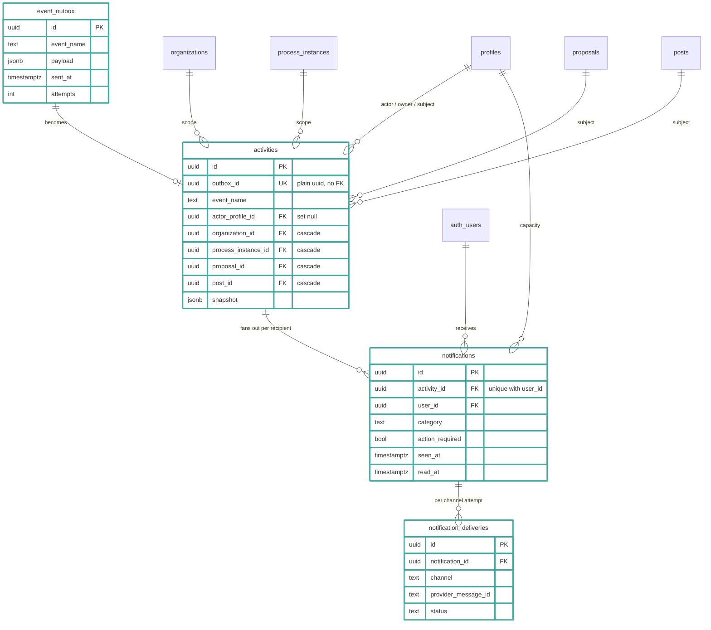
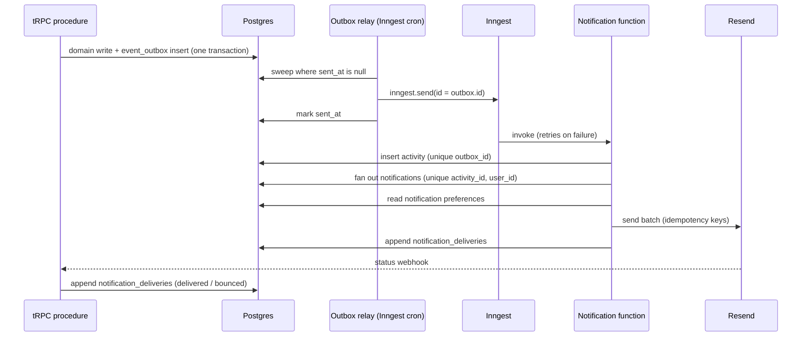

# 0020. Store notifications as outbox, activity, and per-recipient rows

Date: 2026-11-12

## Status

Proposed

## Context

We want to store activity-feed events and email-notification events in
one shared transactional model: the same stored event powers the feed
and the channel fan-out of ADR 0004. Prior to this ADR's
implementation the two have no common record — a tRPC procedure calls `inngest.send` and a workflow function
sends the email — so there is no feed to read back and no row that ties
an event to what it delivered.

The design follows a pattern from systems that keep a materialized
transaction log: a consumer replays the log from a stored cursor, so a
crashed consumer misses nothing. Postgres has no materialized
transaction log, so an outbox table written inside the domain
transaction gives the same guarantee: an event exists if and only if
the write committed.

In scope: the tables, their delivery semantics, and their foreign-key
rules. Out of scope: which events notify whom (ADR 0002) and which
channel carries them (ADR 0004).

## Decision

We will store notifications in four tables.

- `event_outbox` — written in the same transaction as the domain write.
  A relay (an Inngest cron) sweeps unsent rows, one sweep at a time, and
  sends each to Inngest with the row `id` as the event id. Delivery is
  at least once; `sent_at` and `attempts` record progress, and sent rows
  are pruned after 30 days.
- `activities` — one row per domain event, created by the workflow
  function. A unique index on `outbox_id` makes replay idempotent;
  the column is a plain uuid, not a foreign key, so pruning the outbox
  never blocks on or deletes feed history, and replay only needs the
  key within Inngest's retry window, long before the 30-day prune. The
  row denormalizes its scopes (actor, owner profile, organization,
  process instance, proposal, post, profile) and carries a `snapshot`
  jsonb for rendering. Each feed scope gets a composite index
  `(scope, created_at desc, id desc)`; shared feeds read this table in
  database order (no JS sorts).
- `notifications` — the per-recipient fan-out, unique on
  `(activity_id, user_id)`, with `category`, `action_required` (stamped
  from the event name), and `seen_at` / `read_at` state. Partial indexes
  serve the unread badge and the needs-action tab.
- `notification_deliveries` — an append-only log of per-channel
  attempts, keyed back from provider webhooks by `provider_message_id`.

New tables carry the thick teal border; plain entities already exist.



A service emits an event by writing the outbox row inside its own
transaction, in place of calling `inngest.send`:

```ts
await db.transaction(async (tx) => {
  const [proposal] = await tx.insert(proposals).values(input).returning();
  await tx.insert(eventOutbox).values({
    eventName: Events.proposalSubmitted.name,
    payload: { proposalId: proposal.id, actorProfileId: profile.id },
  });
});
```

One Inngest function per event consumes the outbox row and writes the
remaining three tables:



A crash at any arrow replays from the top: every write below
`inngest.send` is idempotent, so a retry re-sends nothing and
re-creates nothing.

Foreign keys follow the schema's delete mechanism: scope columns
(`organization_id`, `process_instance_id`, `proposal_id`, `post_id`)
cascade, so a deleted scope takes its feed with it; `actor_profile_id`
sets null, so a departed actor does not erase events from other
people's feeds; `notifications` and `notification_deliveries` cascade
from their parents.

## Consequences

- A rollback emits nothing, and a crash between any two steps replays
  safely: the `outbox_id` and `(activity_id, user_id)` uniques absorb
  the duplicate rows, and Resend idempotency keys absorb the duplicate
  sends.
- Every feed is one indexed query with a `(created_at, id)` cursor.
- Fan-out writes one row per recipient per event. A process-wide event
  in a large process writes thousands of rows; the write is batched and
  idempotent, but the volume is real.
- The `snapshot` outlives edits to its source, so a feed renders
  history, not current state — and a moderation delete must scrub the
  activities that snapshotted the removed content.
- `thingsYouFollow` needs three events that do not exist yet
  (`proposal/followed`, `profile/followed`, `decision/joined`).
- Reading `activities` for a shared feed must still apply visibility:
  the scope filter alone would unmask anonymous actors and restricted
  proposals through the snapshot.
