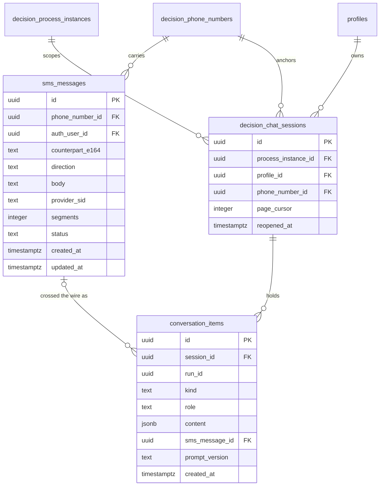

# 0023. Add conversation storage tables

Date: 2026-11-18

## Status

Proposed

## Context

## Decision

### Schema

```sql
CREATE TABLE sms_messages (
  id uuid PRIMARY KEY DEFAULT gen_random_uuid(),
  phone_number_id uuid REFERENCES decision_phone_numbers (id) ON DELETE SET NULL,
  auth_user_id uuid REFERENCES auth.users (id) ON DELETE SET NULL,
  counterpart_e164 text,
  direction text NOT NULL CHECK (direction IN ('inbound', 'outbound')),
  body text NOT NULL,
  provider_sid text,
  segments integer,
  status text NOT NULL DEFAULT 'received'
    CHECK (status IN ('received', 'queued', 'sent', 'delivered', 'failed')),
  created_at timestamptz NOT NULL DEFAULT now(),
  updated_at timestamptz NOT NULL DEFAULT now()
);

CREATE UNIQUE INDEX sms_messages_provider_sid_uniq
  ON sms_messages (provider_sid)
  WHERE provider_sid IS NOT NULL;

CREATE INDEX sms_messages_line_created_idx
  ON sms_messages (phone_number_id, created_at);

CREATE TABLE conversation_items (
  id uuid PRIMARY KEY DEFAULT gen_random_uuid(),
  session_id uuid NOT NULL
    REFERENCES decision_chat_sessions (id) ON DELETE CASCADE,
  run_id uuid,
  kind text NOT NULL
    CHECK (kind IN ('message', 'tool_call', 'tool_output', 'command')),
  role text CHECK (role IN ('user', 'assistant')),
  content jsonb NOT NULL,
  sms_message_id uuid REFERENCES sms_messages (id) ON DELETE SET NULL,
  prompt_version text,
  created_at timestamptz NOT NULL DEFAULT now()
);

CREATE INDEX conversation_items_session_created_idx
  ON conversation_items (session_id, created_at);
```

### Entity diagram



## Consequences
