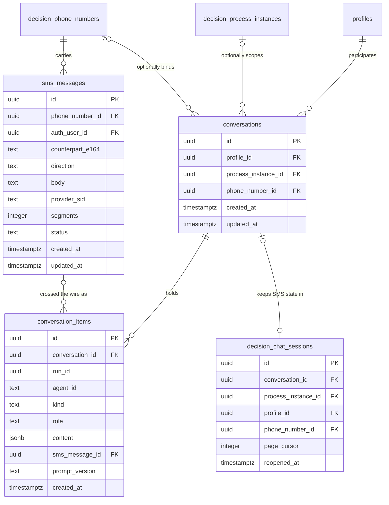

# 0023. Add conversation storage tables

Date: 2026-11-18

## Status

Proposed

## Context

In the Common application we want to support a couple of types of
conversation style user interactions. First, we want to support SMS
based conversations that allow a user to interact with Common via an
SMS keyword system. As part of that, we will also have a LLM agent
with memory that allows users to participate in the voting process via
SMS and an LLM agent.

Additionally, we are hoping to build various different types of LLM
agents. These agents will likely be accessed through the interface,
but this UI has not been designed yet. These agents will need to store
their memory in our database.

The goal of this ADR is to establish a storage format for
conversational-like interactions that includes non-SMS LLM agents,
SMS-based LLM agents, and SMS keyword interactions.

## Decision

We add three tables.

`conversations` anchors every conversation and is channel-agnostic. A
row names the participant profile. It optionally names a decision and
a phone line; a web agent conversation names neither.

`conversation_items` stores the ordered, typed items of one
conversation: messages, tool calls, tool outputs, and keyword
commands. The `content` column holds a ModelMessage-compatible jsonb
payload, so stored items replay directly as model input. An item that
crossed the wire links to its `sms_messages` row; an `agent_id` names
the agent that produced an assistant item.

`sms_messages` logs every SMS that crosses a decision line, including
traffic from senders with no conversation.

`decision_chat_sessions` keeps its typed SMS state and gains a
reference to its conversation. The conversation log records
interactions; domain truth stays in the domain tables (ADR 0009). All
three tables carry the standard service-role RLS policies.

### Schema

```sql
CREATE TABLE conversations (
  id uuid PRIMARY KEY DEFAULT gen_random_uuid(),
  profile_id uuid NOT NULL
    REFERENCES profiles (id) ON DELETE CASCADE,
  process_instance_id uuid
    REFERENCES decision_process_instances (id) ON DELETE CASCADE,
  phone_number_id uuid
    REFERENCES decision_phone_numbers (id) ON DELETE SET NULL,
  created_at timestamptz NOT NULL DEFAULT now(),
  updated_at timestamptz NOT NULL DEFAULT now()
);

CREATE INDEX conversations_profile_created_idx
  ON conversations (profile_id, created_at);

CREATE TABLE sms_messages (
  id uuid PRIMARY KEY DEFAULT gen_random_uuid(),
  phone_number_id uuid REFERENCES decision_phone_numbers (id) ON DELETE SET NULL,
  auth_user_id uuid REFERENCES auth.users (id) ON DELETE SET NULL,
  counterpart_e164 text,
  direction text NOT NULL CHECK (direction IN ('inbound', 'outbound')),
  body text NOT NULL,
  provider_sid text,
  segments integer,
  status text NOT NULL DEFAULT 'received'
    CHECK (status IN ('received', 'queued', 'sent', 'delivered', 'failed')),
  created_at timestamptz NOT NULL DEFAULT now(),
  updated_at timestamptz NOT NULL DEFAULT now(),
  CHECK (auth_user_id IS NOT NULL OR counterpart_e164 IS NOT NULL)
);

CREATE UNIQUE INDEX sms_messages_provider_sid_uniq
  ON sms_messages (provider_sid)
  WHERE provider_sid IS NOT NULL;

CREATE INDEX sms_messages_line_created_idx
  ON sms_messages (phone_number_id, created_at);

CREATE TABLE conversation_items (
  id uuid PRIMARY KEY DEFAULT gen_random_uuid(),
  conversation_id uuid NOT NULL
    REFERENCES conversations (id) ON DELETE CASCADE,
  run_id uuid,
  agent_id text,
  kind text NOT NULL
    CHECK (kind IN ('message', 'tool_call', 'tool_output', 'command')),
  role text CHECK (role IN ('user', 'assistant')),
  content jsonb NOT NULL,
  sms_message_id uuid REFERENCES sms_messages (id) ON DELETE SET NULL,
  prompt_version text,
  created_at timestamptz NOT NULL DEFAULT now(),
  CHECK ((kind = 'message') = (role IS NOT NULL))
);

CREATE INDEX conversation_items_conversation_created_idx
  ON conversation_items (conversation_id, created_at);

ALTER TABLE decision_chat_sessions
  ADD COLUMN conversation_id uuid
    REFERENCES conversations (id) ON DELETE SET NULL;

CREATE UNIQUE INDEX decision_chat_sessions_conversation_uniq
  ON decision_chat_sessions (conversation_id)
  WHERE conversation_id IS NOT NULL;
```

### Entity diagram



## Consequences
