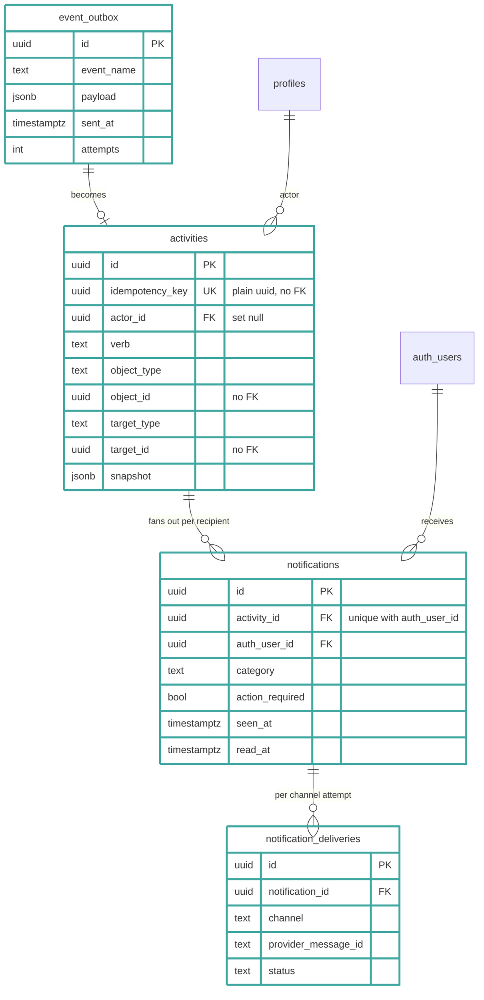
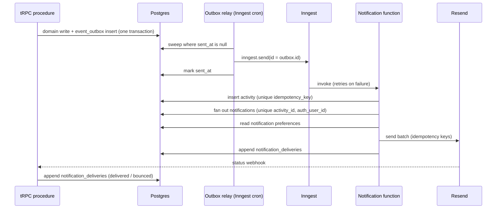

# 0023. Store notifications as outbox, activity, and per-recipient rows

Date: 2026-11-12

## Status

Proposed

## Context

We want to store activity-feed events and email-notification events in
one shared transactional model: the same stored event powers the feed
and the channel fan-out of ADR 0004. Prior to this ADR's
implementation the two have no common record — a tRPC procedure calls `inngest.send` and a workflow function
sends the email — so there is no feed to read back and no row that ties
an event to what it delivered.

The design follows a pattern from systems that keep a materialized
transaction log: a consumer replays the log from a stored cursor, so a
crashed consumer misses nothing. Postgres has no materialized
transaction log, so an outbox table written inside the domain
transaction gives the same guarantee: an event exists if and only if
the write committed.

In scope: the tables, their delivery semantics, and their foreign-key
rules. Out of scope: which events notify whom (ADR 0002) and which
channel carries them (ADR 0004).

## Decision

We will store notifications in four tables.

- `event_outbox` — written in the same transaction as the domain write.
  A relay (an Inngest cron) sweeps unsent rows, one sweep at a time, and
  sends each to Inngest with the row `id` as the event id. Delivery is
  at least once; `sent_at` and `attempts` record progress, and sent rows
  are pruned after 30 days.
- `activities` — one row per domain event, created by the workflow
  function, in the activity-streams shape: `actor_id`, `verb`,
  `object_type` + `object_id`, and `target_type` + `target_id`. The
  actor is a profile — every subject in the activity system has a
  profile row — and keeps a foreign key. The object and target pairs
  carry no foreign key: they name any entity generically, and the
  `snapshot` jsonb carries what a feed renders. A unique index on
  `idempotency_key` makes replay idempotent; the column is a plain
  uuid (the outbox row id), not a foreign key, so pruning the outbox
  never blocks on or deletes feed history, and replay only needs the
  key within Inngest's retry window, long before the 30-day prune.
  The actor, object, and target each get a composite index
  `(..., created_at desc, id desc)`, partial on the id being present;
  shared feeds read this table in database order (no JS sorts).
- `notifications` — the per-recipient fan-out, unique on
  `(activity_id, auth_user_id)`, with `category`, `action_required` (stamped
  from the event name), and `seen_at` / `read_at` state. Partial indexes
  serve the unread badge and the needs-action tab.
- `notification_deliveries` — an append-only log of per-channel
  attempts, keyed back from provider webhooks by `provider_message_id`.

New tables carry the thick teal border; plain entities already exist.



A service emits an event by writing the outbox row inside its own
transaction, in place of calling `inngest.send`:

```ts
await db.transaction(async (tx) => {
  const [proposal] = await tx.insert(proposals).values(input).returning();
  await tx.insert(eventOutbox).values({
    eventName: Events.proposalSubmitted.name,
    payload: { proposalId: proposal.id, actorProfileId: profile.id },
  });
});
```

One Inngest function per event consumes the outbox row and writes the
remaining three tables:



A crash at any arrow replays from the top: every database write below
`inngest.send` is idempotent, so a retry re-creates nothing. The email
send dedupes on a Resend idempotency key, which Resend keeps for 24
hours; before sending, the function also skips any notification whose
deliveries log already records a send.

`actor_id` is the only foreign key on `activities`, and it sets null:
a departed actor does not erase events from other people's feeds. The
object and target ids carry no foreign key, so a deleted object leaves
its id dangling and the event in place; the row renders from its
snapshot — the record of what the object looked like at that time.
`notifications` and `notification_deliveries` cascade from their
parents.

## Consequences

- A rollback emits nothing, and a crash between any two steps replays
  safely on the database side: the `idempotency_key` and
  `(activity_id, auth_user_id)` uniques absorb the duplicate rows. Email
  dedup is narrower: the deliveries check and the Resend idempotency
  key cover a replay, but a crash after the send and before the
  deliveries insert, recovered after Resend's 24-hour key window, sends
  the email again. We accept that rare duplicate rather than risk
  dropping the send.
- Every feed is one indexed query with a `(created_at, id)` cursor.
- Fan-out writes one row per recipient per event. A process-wide event
  in a large process writes thousands of rows; the write is batched and
  idempotent, but the volume is real.
- The `snapshot` outlives edits to its source, so a feed renders
  history, not current state — and a moderation delete must scrub the
  activities that snapshotted the removed content.
- `thingsYouFollow` needs three events that do not exist yet
  (`proposal/followed`, `profile/followed`, `decision/joined`).
- Reading `activities` for a shared feed must still apply visibility:
  the object or target filter alone would unmask anonymous actors and
  restricted proposals through the snapshot.

The four tables grow at different rates and need different storage
rules:

- `event_outbox` stays small by design: payloads hold ids only, and
  sent rows are pruned after 30 days. The partial index on unsent rows
  keeps the sweep fast whatever the table's size.
- `activities` grows with domain events and is kept for the life of its
  subjects. The `snapshot` dominates row size, so it holds only the
  fields a feed renders (ids, names, a title) — never a whole document.
  Its three composite feed indexes (actor, object, target) are the
  write-amplification cost of fast reads.
- `notifications` grows fastest: rows = events x recipients. Marking
  seen or read rewrites the partial unread indexes, and rows leave with
  their activity through the cascade.
- `notification_deliveries` appends one row per channel attempt plus
  one per provider webhook, bounded by notifications x channels.
- We start without partitioning or an archive tier. Feed queries read
  recent rows through `(..., created_at desc, id desc)` indexes, so
  `activities` and `notifications` can move to range partitions on
  `created_at` later without changing a query. Revisit when either
  table nears about 50 million rows.
